# Vistara

**Vision-Language System for Transformer-based Agricultural Disease Recognition and Analysis**

Vistara is an AI-powered agricultural intelligence and foliar pathology diagnostic system designed for farmers, agronomists, crop researchers, and agricultural extension officers. It combines state-of-the-art multimodal vision-language transformer models with field-tested agronomic practices to diagnose crop foliage infections, evaluate foliar videos and photos, identify causal pathogens, calculate calibrated severity indices, and formulate dual-track treatment plans in real time.

---

## 1. What is Vistara

Vistara bridges the gap between field-level crop distress and specialized plant pathology expertise. By evaluating high-resolution foliar photography, canopy video footage, and natural language symptom descriptions, Vistara delivers clinical-grade pathology reports accompanied by immediate, actionable intervention regimens.

### Core Capabilities

- **Multimodal Visual & Video Examination**: Evaluates complex foliar pathology markers across leaf, stem, lesion, and fruit imagery as well as canopy video clips. Detects concentric target rings, angular lesions, water-soaked margins, anthracnose spots, powdery or downy sporulation, rust pustules, and chlorotic halos.
- **Taxonomic Pathogen Classification**: Identifies causal pathogens across fungi, bacteria, viruses, oomycetes, nematodes, and abiotic physiological stresses using standard Latin binomial scientific nomenclature (e.g., *Phytophthora infestans*, *Alternaria solani*, *Xanthomonas campestris*).
- **Calibrated Staging & Severity Index**: Quantifies canopy leaf area affected into calibrated severity tiers (Low, Moderate, Severe, Critical) with a realistic diagnostic confidence score.
- **Dual-Track Intervention Regimen**:
  - *Targeted Chemical Countermeasures*: Registered active ingredients (e.g., Chlorothalonil 75% WP, Azoxystrobin, Mancozeb) with exact water dilution dosages per liter, safety intervals, and re-application schedules.
  - *Organic & Biological Alternatives*: Certified bio-control agents (e.g., *Bacillus subtilis*, *Trichoderma harzianum*, cold-pressed neem kernel extract) and cultural prophylactic measures.
- **Adaptive Model Modes**:
  - **Auto**: Automatically chooses the best balance of speed and detail based on prompt complexity and diagnostic needs.
  - **Quick**: Streamlined for fast answers, quick leaf checks, and rapid preliminary scans.
  - **Expert**: Deep reasoning mode engineered for complex crop issues, multi-lesion analysis, and detailed agronomic treatment regimens.
- **Global Multilingual Consultation**: Built-in support for 15+ regional and international languages (including English, Hindi, Marathi, Telugu, Tamil, Gujarati, Bengali, Punjabi, Kannada, Malayalam, Spanish, French, and Portuguese). The model delivers native-language explanations while strictly preserving Latin binomial taxonomy and telemetry keys.
- **Multi-Mode Clinical Dialogue**:
  - *Mode 1 (Conversational & Identity)*: Responds naturally to greetings and capability queries without generating unnecessary pathology cards.
  - *Mode 2 (Agronomic Follow-up Q&A)*: Answers specific follow-up questions (application timing, rainfastness, tank-mix compatibility) using active session context.
  - *Mode 3 (Clinical Pathology Examination)*: Produces full structured pathology evaluations when symptomatic foliage or video footage is submitted.
- **Persistent Case Workspace**: Full conversation history stored in MongoDB, with chronological case grouping (Today, Yesterday, Previous 7 Days), lazy-loaded dialogue turns, and an editorial publication aesthetic.

---

## 2. The Problem Statement

Plant diseases and foliar infections account for an estimated 20% to 40% of global crop yield loss annually, severely impacting agricultural productivity and food security.

### Key Challenges in the Field

1. **Scarcity of Qualified Agronomists**: Extension officers and crop pathologists are frequently unavailable in remote farming regions, causing critical treatment delays while infections spread across crop canopies.
2. **Diagnostic Misidentification**: Abiotic physiological stress (such as magnesium or potassium deficiencies and salinity scorch) frequently mimics early-stage biotic fungal or viral infections. Misdiagnosis leads to inappropriate, ineffective chemical applications.
3. **Pesticide Overapplication**: Without precise active-ingredient dilution rates and disease staging, growers often resort to broad-spectrum chemical overuse, inducing pathogen resistance, degrading soil microbiomes, and harming beneficial pollinators.
4. **Limitations of Traditional Computer Vision**: Early convolutional neural network (CNN) classifiers produce blunt, single-label outputs (e.g., *"Tomato Early Blight 82%"*) without explanation, clinical reasoning, or actionable farming countermeasures, and cannot answer follow-up questions regarding field application conditions.

Vistara solves these problems by providing an interactive, vision-language diagnostic workspace that delivers thorough agronomic guidance and answers farmer questions conversationally.

---

## 3. System Architecture

The following diagram illustrates the end-to-end architecture of Vistara, from client interface to the vision-language reasoning engine and persistent storage layer:

```mermaid
flowchart TD
    subgraph Frontend["Frontend Client (Vite + React 18 + Tailwind v3)"]
        UI["Chatbot Workspace UI"]
        InputDeck["Input Deck (Text, Voice, Specimen Photo & Video)"]
        Sidebar["Chronological Case History, Search & Language Flyout"]
        Header["Header Bar (Auto / Quick / Expert Model Selector & Theme Toggle)"]
        ReportCard["Pathology Assessment Bento Card"]
        ChatService["ChatService (Axios SSE Client)"]
    end

    subgraph ReverseProxy["Vite Dev Server Proxy"]
        Proxy["Proxy: /api -> http://localhost:5000"]
    end

    subgraph Backend["Backend Service (Node.js + Express)"]
        Router["Express API Router (/api/chat, /api/health, /api/users)"]
        Validator["Request Validation (Zod Schemas)"]
        DiagService["ChatDiagnosticService (SSE Pipeline Orchestrator)"]
        AIService["AIService (Multimodal Streaming & Prompt Assembly)"]
        ContextService["ContextService (In-Memory Session Context)"]
        Parser["ResponseParser (Markdown + JSON Extraction)"]
        HistoryService["ChatHistoryService (Case CRUD & Intelligent Titles)"]
        Prompts["Pathology Prompts (leafAnalysis & videoAnalysis)"]
    end

    subgraph ExternalAI["External Vision-Language Provider"]
        Gateway["Vercel AI Gateway"]
        VLModel["Multimodal Transformer VL Models (Mimo v2.6 Flash / Qwen 3.7 Flash)"]
    end

    subgraph Database["Database Layer (MongoDB)"]
        MongoDB[(MongoDB Cluster)]
        ChatCollection["chats collection (Indexed by userId, updatedAt)"]
        UserCollection["users collection"]
    end

    InputDeck --> UI
    Header --> UI
    Sidebar --> UI
    UI --> ChatService
    ChatService --> Proxy
    Proxy --> Router

    Router --> Validator
    Validator --> DiagService

    DiagService --> ContextService
    DiagService --> HistoryService
    DiagService --> AIService

    AIService --> Prompts
    AIService --> Gateway
    Gateway --> VLModel
    VLModel -- "Streaming Reasoning (<think>) & Diagnosis Deltas" --> AIService

    AIService --> Parser
    Parser --> DiagService

    DiagService --> HistoryService
    HistoryService --> MongoDB
    MongoDB --- ChatCollection
    MongoDB --- UserCollection

    DiagService -- "Server-Sent Events (SSE: text, thinking, data)" --> ChatService
    ChatService --> ReportCard
    ChatService --> UI
```



---

## 4. The Approach

Vistara employs a four-tiered architectural approach to deliver robust, safe, and actionable agricultural intelligence:

### 1. Multimodal Diagnostic Prompt Engineering
Specialized system prompts grounded in plant pathology (`leafAnalysis.prompt.ts` and `videoAnalysis.prompt.ts`) guide the vision-language model to inspect lesion morphology, host crop biology, pathogen taxonomy, and visual severity percentages. Multilingual directives seamlessly adapt responses into the farmer's chosen language while maintaining standardized English JSON schema tags for frontend telemetry.

### 2. Dual-Track Agronomic Countermeasures
Every pathology diagnosis delivers two concurrent treatment pathways:
- **Chemical Control**: Formulated for severe or critical infections requiring immediate curative intervention, detailing active ingredients, concentration percentages, and exact water dilution ratios (e.g., 2.0 g/L).
- **Biological / Organic Alternatives**: Formulated for preventive buffer zones or organic operations, recommending bio-fungicides (*Trichoderma*, *Bacillus* strains) and cultural canopy sanitation.

### 3. Real-Time Streaming & Transparent Reasoning
Using Server-Sent Events (SSE), Vistara streams model completions back to the client in real time. Internal reasoning traces (`<think>` blocks) are separated and routed into a dedicated, collapsible thought-process panel, giving agronomists full visibility into the clinical deduction process.

### 4. Resilient Persistence & Context Continuity
- Multi-turn context understanding maintains crop and disease context across follow-up queries.
- Complete dialogue turns, specimen images, video metadata, and parsed pathology reports are indexed in MongoDB.
- Sessions are saved with intelligent title derivation, ensuring casual greetings are labeled as *"General Consultation"* and specimen scans are labeled with their diagnosed crop and disease (e.g., *"Tomato Late Blight Analysis"*).

---

## 5. Local Setup & Installation

### Prerequisites

Ensure you have the following installed on your development workstation:
- **Node.js**: v20+ (v21+ recommended)
- **npm**: v9.0.0 or higher
- **MongoDB**: Community Server v6.0+ running locally on port `27017` (or an active MongoDB Atlas connection URI)
- **Vercel AI Gateway Key**: API key providing access to supported vision-language models (`xiaomi/mimo-v2.6-flash`, `alibaba/qwen3.7-flash`)

---

### Step 1: Clone Repository

```bash
git clone https://github.com/Yash-Prajapati7/Vistara.git
cd "Vistara"
```

---

### Step 2: Configure & Start the Backend

1. Navigate to the backend directory:
   ```bash
   cd backend
   ```

2. Install backend dependencies:
   ```bash
   npm install
   ```

3. Create your environment configuration file:
   ```bash
   cp .env.example .env
   ```

4. Edit `backend/.env` with your credentials:
   ```env
   # Server Configuration
   PORT=5000
   NODE_ENV=development

   # Vercel AI Gateway Configuration
   AI_GATEWAY_API_KEY=your_actual_api_key_here

   # Vision-Language Model Identifier
   AI_MODEL_ID=xiaomi/mimo-v2.6-flash

   # CORS & Upload Limits (Supporting high-res photos and canopy videos)
   FRONTEND_ORIGIN=http://localhost:5173
   BODY_LIMIT=50mb

   # MongoDB Connection
   MONGODB_URI=mongodb://127.0.0.1:27017/vistara_diagnostics
   MONGODB_DB_NAME=vistara_diagnostics
   ```

5. Verify TypeScript compilation:
   ```bash
   npm run type-check
   ```

6. Start the backend development server:
   ```bash
   npm run dev
   ```
   *The backend will start listening on `http://localhost:5000` and automatically connect to MongoDB.*

---

### Step 3: Configure & Start the Frontend

1. Open a new terminal and navigate to the frontend directory:
   ```bash
   cd frontend
   ```

2. Install frontend dependencies:
   ```bash
   npm install
   ```

3. Verify production bundle build:
   ```bash
   npm run build
   ```

4. Launch the local Vite development server:
   ```bash
   npm run dev
   ```
   *The frontend will launch at `http://localhost:5173` with automatic API proxying to `http://localhost:5000`.*

---

### Step 4: Verify System Health

1. Open `http://localhost:5173` in your browser.
2. Check backend health in terminal or browser:
   ```bash
   curl http://localhost:5000/api/health
   ```
   Expected response:
   ```json
   {
     "status": "healthy",
     "database": "connected",
     "model": "xiaomi/mimo-v2.6-flash",
     "uptimeSeconds": 12,
     "environment": "development"
   }
   ```

3. Submit a test foliar photograph, upload a canopy video, or ask a question (e.g., *"My tomato leaves show circular brown spots with concentric rings"*) to test the vision-language diagnostic pipeline.

---

## 6. Project Directory Structure

```
├── .agents/
│   └── AGENTS.md               # Architecture and frontend design guidelines
├── backend/
│   ├── src/
│   │   ├── config/
│   │   │   └── database.ts     # Resilient MongoDB/Mongoose connection manager
│   │   ├── constants/
│   │   │   ├── dbConstants.ts  # Database collections, fields, and query tokens
│   │   │   ├── modelConfig.ts  # Vision-language model parameters and defaults
│   │   │   └── serverStrings.ts# Centralized API routes, headers, and SSE events
│   │   ├── middleware/
│   │   │   ├── errorHandler.ts # Global Express error handling middleware
│   │   │   └── requestValidator.ts # Zod schema validation for payloads
│   │   ├── models/
│   │   │   ├── chatModel.ts    # Mongoose schema for chats, turns, and pathology
│   │   │   └── userModel.ts    # Mongoose schema for agronomist profiles
│   │   ├── prompts/
│   │   │   ├── leafAnalysis.prompt.ts  # Multimodal photo pathology prompt
│   │   │   └── videoAnalysis.prompt.ts # Multimodal video pathology prompt
│   │   ├── routes/
│   │   │   ├── chatRoutes.ts   # /api/chat streaming, session, and title routes
│   │   │   ├── healthRoutes.ts # /api/health monitoring endpoint
│   │   │   └── userRoutes.ts   # /api/users profile endpoints
│   │   ├── services/
│   │   │   ├── aiService.ts    # Vercel AI SDK integration & multimodal streaming
│   │   │   ├── chatDiagnosticService.ts # SSE pipeline orchestration
│   │   │   ├── chatHistoryService.ts    # MongoDB CRUD and intelligent titles
│   │   │   ├── contextService.ts        # In-memory session context cache
│   │   │   ├── responseParser.ts        # Markdown and JSON report extraction
│   │   │   └── userService.ts           # Agronomist profile management
│   │   ├── types/              # TypeScript type definitions
│   │   ├── utils/
│   │   │   └── logger.ts       # Structured logger
│   │   ├── app.ts              # Express application factory
│   │   └── server.ts           # Server entry point & graceful shutdown hooks
│   ├── .env.example            # Backend environment template
│   ├── package.json            # Backend scripts and dependencies
│   └── tsconfig.json           # Backend TypeScript configuration
├── frontend/
│   ├── public/
│   │   └── favicon.svg         # High-contrast geometric octagonal network favicon
│   ├── src/
│   │   ├── components/
│   │   │   ├── Chat/
│   │   │   │   ├── ChatHeader.tsx  # Header bar with Auto/Quick/Expert selector & theme toggle
│   │   │   │   ├── EmptyState.tsx  # Editorial welcoming screen with prompt chips
│   │   │   │   ├── MessageItem.tsx # Chat turn bubble and pathology report card
│   │   │   │   └── MessageList.tsx # Auto-scrolling conversation container
│   │   │   ├── InputDeck/
│   │   │   │   ├── ChatInput.tsx   # Floating input deck with photo & video upload
│   │   │   │   └── ImagePreview.tsx# Specimen media thumbnail chip with dismiss
│   │   │   ├── Modal/
│   │   │   │   └── DeleteConfirmModal.tsx # Delete confirmation dialog
│   │   │   ├── Sidebar/
│   │   │   │   ├── AccountSection.tsx # Agronomist profile card & language selector flyout
│   │   │   │   ├── ChatHistory.tsx    # Chronologically grouped session list with delete action
│   │   │   │   ├── SearchBar.tsx      # Real-time case filter with Ctrl+K shortcut
│   │   │   │   └── Sidebar.tsx        # Collapsible drawer wrapper
│   │   │   └── VistaraLogo.tsx # Pure SVG octagonal geometric network branding
│   │   ├── constants/
│   │   │   └── uiStrings.ts    # Single source of truth for all UI strings
│   │   ├── context/
│   │   │   └── ThemeContext.tsx# Light/dark mode state provider
│   │   ├── data/
│   │   │   └── mockData.ts     # Offline fallback datasets and suggestion prompts
│   │   ├── services/
│   │   │   └── chatService.ts  # Axios SSE client and backend API integration
│   │   ├── types/              # Frontend TypeScript definitions
│   │   ├── App.tsx             # Root workspace container and state orchestration
│   │   ├── index.css           # Tailwind base styles and custom scrollbars
│   │   └── main.tsx            # React application entry point
│   ├── index.html              # HTML shell with EB Garamond & Inter webfonts
│   ├── package.json            # Frontend scripts and dependencies
│   ├── tailwind.config.js      # Design tokens (ElevenLabs editorial palette & Zinc 900 dark theme)
│   ├── tsconfig.json           # Frontend TypeScript configuration
│   └── vite.config.ts          # Vite configuration with /api proxy
├── DESIGN_PLAN.md              # Engineering roadmap and design system specifications
└── README.md                   # Project documentation
```

---

## 7. Design & Code Standards

- **Zero Emojis**: Emojis are strictly banned across the UI, mock data, button labels, and code comments.
- **Iconography**: Exclusively uses `lucide-react` icons.
- **Vector Branding**: Uses pure SVG octagonal geometric network icons (`VistaraLogo.tsx` and `favicon.svg`) with `currentColor` scaling, avoiding bitmap degradation or background tile artifacts.
- **Typography**: Display headings use **EB Garamond 300** (Light serif, unbolded) for an editorial publication aesthetic; body, navigation, badges, and controls use **Inter**.
- **Centralized String Constants**: Hardcoded strings are disallowed in UI components; all labels, placeholders, and status text are maintained in `frontend/src/constants/uiStrings.ts` and `backend/src/constants/serverStrings.ts`.
- **Refined Theme Aesthetics**: Light and dark mode support with tailored Tailwind CSS tokens. Dark mode uses a clean Zinc 900 (`#18181b`) canvas with `#1f1f23` elevated surfaces for high-contrast, distraction-free clinical review.
